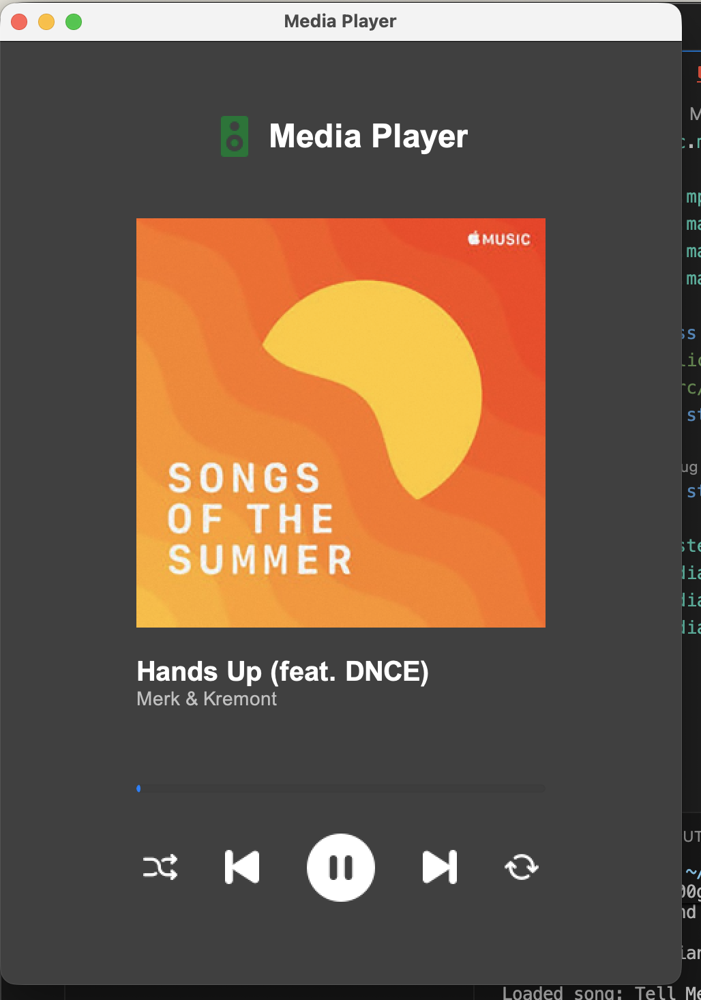
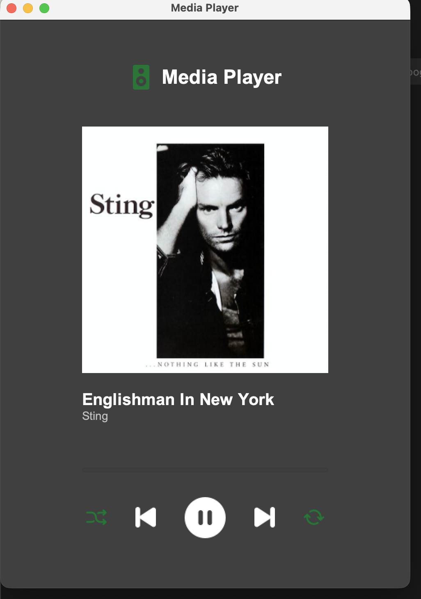

# Media Player

A desktop MP3 player written in Java (Swing). It plays music from a local folder, shows the album cover, track title and artist, and lets you control playback.

> **Educational project.** It was created for learning purposes, mainly to practice building an application with the **MVC** architecture and the **Observer** pattern in Java.

## Screenshots

<table>
  <tr>
    <td align="center">
      <br>
      <sub>Playing a track (cover art is read from the ID3 tags)</sub>
    </td>
    <td align="center">
      <br>
      <sub>Shuffle and repeat enabled (highlighted in green)</sub>
    </td>
  </tr>
</table>

## Features

- Play / pause, next and previous track
- Shuffle mode
- Repeat mode (automatically plays the next track when the current one ends)
- Track title, artist and album cover from ID3 tags
- Playback progress bar

## Architecture

The project follows the **MVC** architecture (**Model → Controller → View**):

- **Model** (`MediaPlayerModel`): player logic and state
- **View** (`MediaPlayerView`): Swing user interface
- **Controller** (`MediaPlayerController`): connects the Model and the View

The layers communicate using the **Observer** pattern. The `Observable` interface plays the role of the **Subject**: both the Model and the View are subjects, and the Controller subscribes to them as an observer. Because of this, the Model and the View know nothing about each other.

## Tech Stack

- **Java 22+**
- **Swing / AWT** for the user interface
- **[JLayer](https://www.javazoom.net/javalayer/javalayer.html)** for MP3 playback
- **[mp3agic](https://github.com/mpatric/mp3agic)** for reading ID3 tags

Both libraries are included in the `lib/` folder, so nothing else needs to be installed.

## Project Structure

```
Player/
├── lib/
│   ├── jl1.0.1.jar                      # JLayer
│   └── mp3agic.jar                      # mp3agic
└── src/main/
    ├── java/
    │   ├── Main.java                    # entry point
    │   ├── model/
    │   │   └── MediaPlayerModel.java    # Model
    │   ├── gui/
    │   │   └── MediaPlayerView.java     # View
    │   ├── control/
    │   │   └── MediaPlayerController.java  # Controller
    │   ├── interfaces/
    │   │   ├── Observable.java          # Subject interface
    │   │   └── observer/                # Observer interfaces
    │   ├── files/                       # music loading and track data
    │   ├── img/                         # cover art and UI icons
    │   ├── stream/                      # background threads helper
    │   └── volume/                      # volume control
    └── resources/img/                   # UI icons
```

## Getting Started

### Requirements

- JDK 22 or newer

### Run

1. Clone the repository:

   ```bash
   git clone https://github.com/ArseniZar/Player.git
   cd Player
   ```

2. Set the path to your music folder (with `.mp3` files) in `src/main/java/Main.java`:

   ```java
   public static final String FOLDER_MUSIC = "/path/to/your/music";
   ```

3. Build and run the project **from the repository root**:

   macOS / Linux:

   ```bash
   find src -name "*.java" > sources.txt
   javac -cp "lib/*" -d out @sources.txt
   java -cp "out:lib/*" src.main.java.Main
   ```

   Windows (use `;` instead of `:` in the classpath):

   ```
   java -cp "out;lib/*" src.main.java.Main
   ```

   You can also run the `Main` class from your IDE.

## Known Limitations

- Only MP3 files are supported.
- Pause stops the player completely, so pressing Play again starts the track from the beginning.
- Volume control is not connected yet.
- The music folder path is set in the code.